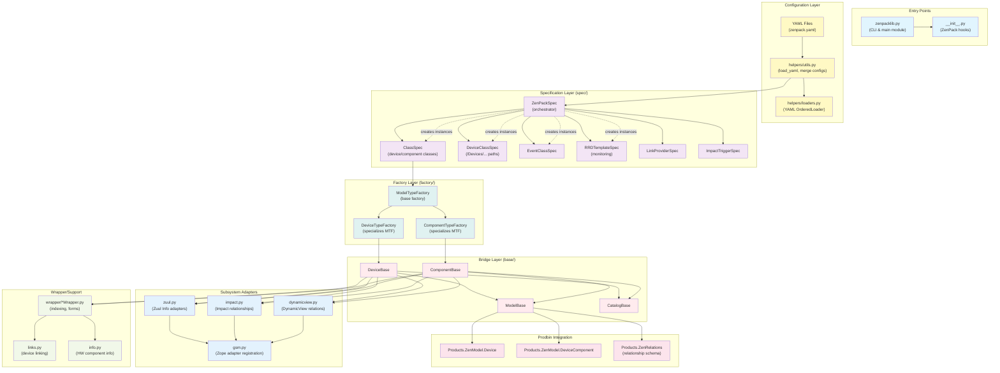
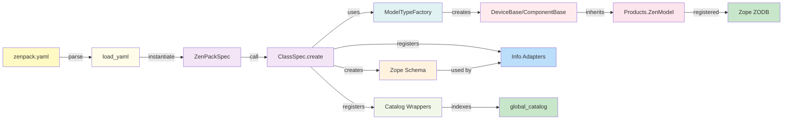
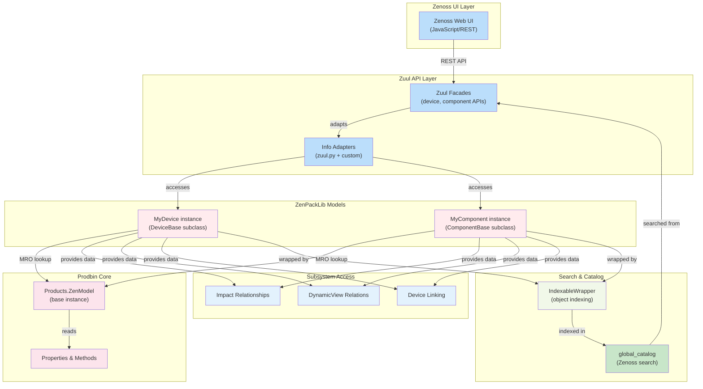
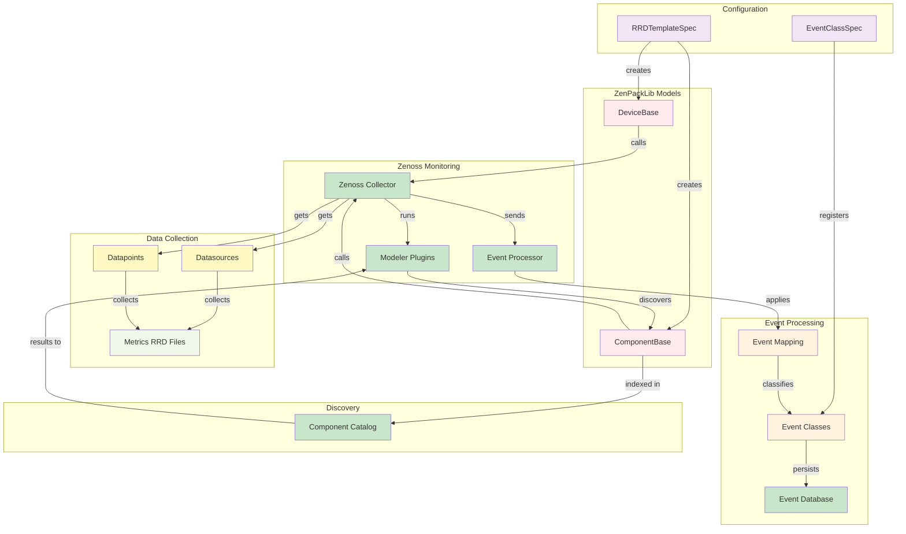
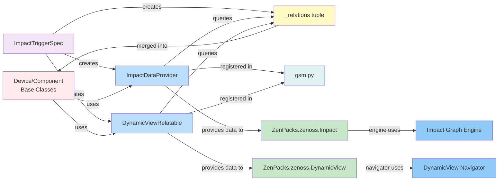
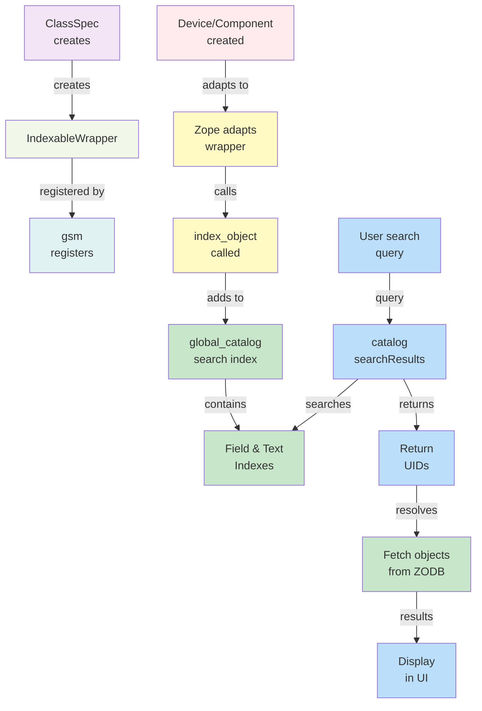
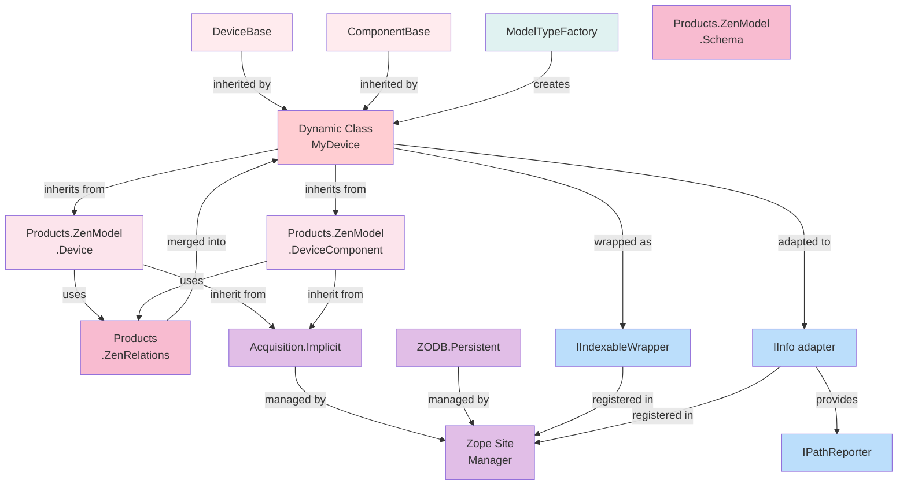

# ZenPackLib: Comprehensive Reverse Engineering Guide

**Date**: February 19, 2026  
**Project**: ZenPacks.zenoss.ZenPackLib  
**Repository**: zenoss/ZenPacks.zenoss.ZenPackLib (develop branch)  
**Purpose**: Complete architectural analysis and reverse engineering of ZenPackLib and its integration with zenoss-prodbin

---

## Table of Contents

1. [Executive Summary](#executive-summary)
2. [Project Overview](#project-overview)
3. [Module Hierarchy & Structure](#module-hierarchy--structure)
4. [Module Interaction Architecture](#module-interaction-architecture)
5. [Dataflow Analysis - All Scenarios](#dataflow-analysis---all-scenarios)
6. [Prodbin Bridge Integration Points](#prodbin-bridge-integration-points)
7. [Architectural Patterns](#architectural-patterns)
8. [Module Interaction Reference Table](#module-interaction-reference-table)
9. [Critical Code Paths](#critical-code-paths)
10. [Dependency & Import Analysis](#dependency--import-analysis)

---

## Executive Summary

**ZenPackLib** is a **declarative bridge framework** that abstracts the complexity of Zenoss's object model by providing a YAML-based configuration system that automatically generates model classes (Devices, Components) and integrates them with Zenoss subsystems.

### Key Characteristics

| Aspect                   | Description                                                            |
| ------------------------ | ---------------------------------------------------------------------- |
| **Architecture Pattern** | Specification + Factory + Adapter (3-layer pattern)                    |
| **Configuration Model**  | Declarative YAML → Python Spec objects → Zope/prodbin models           |
| **Code Generation**      | Dynamic class creation at specification initialization time            |
| **Integration Method**   | Zope adapters for Zuul UI, Impact, DynamicView, and search             |
| **Inheritance Model**    | Multiple inheritance: ZenPackLib bases + prodbin classes + Zope mixins |
| **Data Persistence**     | ZODB (Zope Object Database) via Products.ZenModel                      |

### Role as Bridge

ZenPackLib bridges **ZenPacks (customer code) ↔ zenoss-prodbin (core platform)** by:

1. **Abstracting prodbin complexity** - developers write YAML, not Python
2. **Handling object model details** - relationships, properties, schemas computed automatically
3. **Integration automation** - subsystem adapters registered without developer effort
4. **Type safety** - dynamically created classes with proper inheritance chains

---

## Project Overview

### Purpose

ZenPackLib enables ZenPack developers to:

- Define device/component models declaratively in YAML
- Extend Zenoss's monitoring capabilities with custom classes
- Integrate with standard Zenoss subsystems (Zuul UI, Impact, DynamicView)
- Manage properties, relationships, monitoring templates, and events
- Deploy changes without modifying Zenoss core code

### Integration Points

```
┌──────────────────────────────────────────────────────────────┐
│                    ZENOSS PLATFORM (zenoss-prodbin)          │
├──────────────────────────────────────────────────────────────┤
│  Products.ZenModel      Products.Zuul      Products.Events   │
│  (ORM/Persistence)      (UI/API)           (Events)           │
│                                                               │
│  ┌─────────────────────────────────────────────────────────┐ │
│  │         ZENPACKLIB BRIDGE                              │ │
│  │  ┌──────────────────────────────────────────────────┐  │ │
│  │  │ DeviceBase, ComponentBase (bridge base classes) │  │ │
│  │  │  → Wrap Device, DeviceComponent from prodbin    │  │ │
│  │  └──────────────────────────────────────────────────┘  │ │
│  │  ┌──────────────────────────────────────────────────┐  │ │
│  │  │ ModelTypeFactory (dynamic class creation)       │  │ │
│  │  │  → Generates MyDevice, MyComponent, etc.        │  │ │
│  │  └──────────────────────────────────────────────────┘  │ │
│  │  ┌──────────────────────────────────────────────────┐  │ │
│  │  │ Specification Layer (ClassSpec, RRDTemplateSpec)│  │ │
│  │  │  → YAML → Zope objects                          │  │ │
│  │  └──────────────────────────────────────────────────┘  │ │
│  │  ┌──────────────────────────────────────────────────┐  │ │
│  │  │ Adapters (zuul.py, impact.py, dynamicview.py)   │  │ │
│  │  │  → Integrates with Zenoss subsystems            │  │ │
│  │  └──────────────────────────────────────────────────┘  │ │
│  └─────────────────────────────────────────────────────────┘ │
│                                                               │
│  ZenPacks.zenoss.Impact   ZenPacks.zenoss.DynamicView        │
│  (optional subsystems)                                       │
└──────────────────────────────────────────────────────────────┘
         ↓
┌──────────────────────────────────────────────────────────────┐
│              ZENPACK DEVELOPER'S ZENPACKS                    │
│  (uses ZenPackLib to define custom models & integrations)    │
└──────────────────────────────────────────────────────────────┘
```

---

## Module Hierarchy & Structure

### Directory Layout

```
ZenPacks/zenoss/ZenPackLib/
├── zenpacklib.py                          # Main entry point, CLI
├── __init__.py                            # ZenPack installation hooks
├── bin/
│   └── zenpacklib                         # Command-line executable
│
└── lib/
    ├── __init__.py
    │
    ├── base/                              # BRIDGE LAYER
    │   ├── Device.py                      # Device wrapper
    │   ├── DeviceBase.py                  # Device base additions
    │   ├── Component.py                   # Component types
    │   ├── ComponentBase.py               # Component base additions
    │   ├── ModelBase.py                   # Base for all models
    │   └── CatalogBase.py                 # Catalog integration
    │
    ├── factory/                           # FACTORY LAYER
    │   ├── ModelTypeFactory.py            # Dynamic type creation
    │   ├── DeviceTypeFactory.py           # Device specialization
    │   └── ComponentTypeFactory.py        # Component specialization
    │
    ├── spec/                              # SPECIFICATION LAYER
    │   ├── ZenPackSpec.py                 # Root orchestrator
    │   ├── Spec.py                        # Abstract base
    │   ├── ClassSpec.py                   # Device/component classes
    │   ├── DeviceClassSpec.py             # Device class organizers
    │   ├── EventClassSpec.py              # Event class mappings
    │   ├── ProcessClassOrganizerSpec.py   # Process monitoring
    │   ├── LinkProviderSpec.py            # Device linking
    │   ├── ImpactTriggerSpec.py           # Impact relationships
    │   ├── RRDTemplateSpec.py             # Monitoring templates
    │   ├── RRDDatasourceSpec.py           # Data sources
    │   ├── RRDDatapointSpec.py            # Data points
    │   └── ... (additional specs)
    │
    ├── helpers/                           # CONFIGURATION LOADING
    │   ├── utils.py                       # load_yaml(), merge configs
    │   ├── loaders.py                     # YAML OrderedLoader
    │   ├── Dumper.py                      # YAML serialization
    │   └── ZenPackLibLog.py               # Logging utilities
    │
    ├── wrapper/                           # ZUUL/CATALOG WRAPPERS
    │   ├── DeviceIndexableWrapper.py      # Device catalog wrapping
    │   ├── ComponentIndexableWrapper.py   # Component catalog wrapping
    │   ├── ComponentPathReporter.py       # Path information reporter
    │   └── ComponentFormBuilder.py        # UI form building
    │
    ├── gsm.py                            # ADAPTER REGISTRATION
    │   (Zope Global Site Manager integration)
    │
    ├── zuul.py                           # ZUUL UI INTEGRATION
    │   (Info adapters, schema generation)
    │
    ├── info.py                           # INFO ADAPTER REGISTRATION
    │   (HWComponent info adapter)
    │
    ├── impact.py                         # IMPACT SUBSYSTEM
    │   (Relationship data provider)
    │
    ├── dynamicview.py                    # DYNAMICVIEW SUBSYSTEM
    │   (Navigation relations provider)
    │
    ├── links.py                          # DEVICE LINKING
    │   (Link provider implementation)
    │
    ├── utils.py                          # UTILITIES
    │   (Conditional imports, version checks)
    │
    ├── functions.py                      # TOP-LEVEL API
    │   (Public functions for ZenPacks)
    │
    ├── params/                           # PARAMETER VALIDATION
    │   (Spec parameter validation classes)
    │
    ├── libexec/                          # CLI IMPLEMENTATION
    │   └── ZPLCommand.py                 # zenpacklib CLI command
    │
    ├── resources/                        # STATIC RESOURCES
    │   (Templates, example configs)
    │
    ├── migrate/                          # MIGRATION SCRIPTS
    │   (ZenPack install/upgrade hooks)
    │
    └── tests/                            # UNIT TESTS
        (Comprehensive test suite)
```

---

## Module Interaction Architecture

### High-Level Module Dependencies



---

## Dataflow Analysis - All Scenarios

### Scenario 1: Configuration-Time Dataflow (YAML → Model Creation)

**Timeline**: When ZenPack is installed; `zenpack.yaml` is loaded and models are created.



**Detailed Steps**:

1. **Load Phase**: `load_yaml()` reads `zenpack.yaml` and parses it as an OrderedDict using `OrderedLoader`
2. **Spec Instantiation**: `ZenPackSpec.__init__()` is called with the loaded data
   - Creates instances of `ClassSpec`, `DeviceClassSpec`, `EventClassSpec`, `RRDTemplateSpec`, etc.
   - Each spec stores configuration parameters
3. **Class Creation**: `ZenPackSpec.create()` iterates child specs and calls their `.create()` methods
   - `ClassSpec.create()` invokes `ModelTypeFactory()` to generate new classes
   - Factory computes `_relations` property (merged from base classes)
   - Factory generates schema properties from class definition
4. **Model Registration**: Created classes are registered in Zope's ZODB
   - Classes inherit from both ZenPackLib bases and `Products.ZenModel.*`
   - Adapter registration happens in `gsm.py`
5. **Index Creation**: Catalog wrappers register for search indexing
6. **Subsystem Integration**: If installed, Impact and DynamicView adapters register

---

### Scenario 2: Runtime Model Access (ZenPack Models → Zenoss UI)

**Timeline**: User accesses device/component in Zenoss UI; data flows from model to UI.



**Detailed Steps**:

1. **User Action**: User navigates to a device/component page in Zenoss UI
2. **API Call**: UI makes REST call to Zuul API
3. **Facade Access**: Zuul facade (e.g., `DeviceFacade`) is invoked
4. **Adapter Resolution**: Zope's site manager resolves the appropriate Info adapter
   - Adapter is a registered subclass of the model's Info interface
   - Adapters are created by `ClassSpec.create()` and registered in `gsm.py`
5. **Model Instantiation**: Adapter accesses the actual model instance (device/component)
   - Retrieved from ZODB persistence (via Acquisition wrapper)
   - Instance is of type created by `ModelTypeFactory`
6. **Property Access**: Adapter reads properties/methods from model
   - MRO resolution finds property implementations
   - May be from ZenPackLib base, prodbin base, or custom class
7. **Subsystem Queries**: Subsystems call adapters on the model
   - Impact adapter queries relationships
   - DynamicView adapter queries entity relations
   - Link provider queries devices for linking
8. **Catalog Queries**: Search terms are looked up in global_catalog
   - Cache hit or search in indexed attributes
   - Returns model instances for display

---

### Scenario 3: Monitoring Data Collection & Event Processing

**Timeline**: Monitoring collector runs; datasources collect metrics; events are generated and classified.



**Detailed Steps**:

1. **Monitoring Setup**: `RRDTemplateSpec.create()` creates monitoring templates attached to device/component class
2. **Collection Trigger**: Zenoss collector periodically calls `getRRDTemplates()` on device instances
3. **Template Retrieval**: Device returns RRDTemplates with datasources and datapoints configured
4. **Data Collection**: Collector plugins execute based on datasource definitions
   - Datasource plugin executes (e.g., SNMP, HTTP, custom)
   - Datapoints extract metrics from responses
   - Metrics are written to RRD files
5. **Discovery Phase**: Modeler plugins discover components
   - Query `global_catalog` for existing components
   - Call `ObjectMap` to update/create components
   - New components indexed in catalog
6. **Event Generation**: Collector can generate events during collection
7. **Event Processing**: Raw events flow through event processing pipeline
   - `EventClassSpec` rules applied
   - Events classified into `/Events/...` hierarchy
   - Events stored in event database

---

### Scenario 4: Impact & DynamicView Relationship Queries

**Timeline**: Impact engine or DynamicView navigator queries model relationships.



**Detailed Steps**:

1. **Relationship Definition**: `ClassSpec` or `ImpactTriggerSpec` defines relationships in YAML
2. **Schema Computation**: Factory creates `_relations` property during class creation
3. **Adapter Creation**: `impact.py` and `dynamicview.py` create appropriate adapters
4. **Adapter Registration**: `gsm.py` registers adapters in Zope's global site manager
5. **Query Time**:
   - **Impact**: Impact engine queries model instance for relationships
   - **DynamicView**: DynamicView navigator queries for entity relations
6. **Adapter Resolution**: Zope looks up registered adapter for model type
7. **Relationship Retrieval**: Adapter returns relationships by reading `_relations` and querying related objects
8. **Integration**: Engine/navigator uses relationship data for graph/navigation

---

### Scenario 5: Search & Indexing Workflow

**Timeline**: User performs search; indexed objects are retrieved from global_catalog.



**Detailed Steps**:

1. **Registration Phase** (during ZenPack install):
   - `ClassSpec.create()` registers `IndexableWrapper` for the created class
   - Wrapper provides `IIndexableWrapper` interface
   - Zope's adapter registry stores the mapping

2. **Indexing Phase** (when object is created):
   - Device/component created in ZODB
   - Zope automatically adapts it to **IndexableWrapper**
   - Wrapper's `index_object()` method is called
   - Object is added to **global_catalog** with indexed fields (uid, name, path, etc.)

3. **Query Phase** (user searches):
   - Search query (e.g., "device name") comes from Zenoss UI
   - Zuul API calls `catalog.searchResults(name=query)`
   - Catalog searches indexes for matches
   - UIDs of matching objects returned

4. **Retrieval Phase**:
   - UIDs are used to retrieve actual objects from ZODB
   - Objects are returned to UI for display

---

## Prodbin Bridge Integration Points

### Core Integration Architecture



### Key Prodbin Classes Wrapped

| Prodbin Class                       | Wrapped By                               | Purpose                                                  |
| ----------------------------------- | ---------------------------------------- | -------------------------------------------------------- |
| `Products.ZenModel.Device`          | `DeviceBase` → `DeviceTypeFactory`       | Root device class; provides core device methods          |
| `Products.ZenModel.DeviceComponent` | `ComponentBase` → `ComponentTypeFactory` | Base for all component types (CPU, Fan, Interface, etc.) |
| `Products.ZenModel.ManagedEntity`   | `ModelBase`                              | Common base for objects with monitoring/events           |
| `Products.ZenModel.ZenossSecurity`  | (inherited)                              | Security/permission mixin                                |
| `Products.ZenRelations.ZopeVersion` | (inherited)                              | Zope relationship schema support                         |
| `Acquisition.Implicit`              | (inherited)                              | Object composition / attribute lookup                    |
| `ZODB.Persistent`                   | (inherited)                              | ZODB persistence support                                 |

### Integration Points at Code Level

#### 1. **Device Class Inheritance**

```python
# In factory/DeviceTypeFactory.py
Device = DeviceTypeFactory('Device',
    (Products.ZenModel.Device, DeviceBase))

# Result: Device instance MRO is:
# [Device, DeviceBase, Products.ZenModel.Device,
#  Products.ZenModel.ManagedEntity, Acquisition.Implicit,
#  ZODB.Persistent, object]
```

#### 2. **Component Registration**

```python
# In lib/Component.py
Component = ComponentTypeFactory('Component',
    (Products.ZenModel.DeviceComponent, ComponentBase))

# Result: Component instance MRO is:
# [Component, ComponentBase, Products.ZenModel.DeviceComponent,
#  Products.ZenModel.ManagedEntity, Acquisition.Implicit,
#  ZODB.Persistent, object]
```

#### 3. **Relationship Schema Binding**

```python
# In factory/ModelTypeFactory.py, _relations property:
# - Reads _v_local_relations from ClassSpec
# - Merges with base class _relations
# - Returns tuple compatible with Products.ZenRelations
# - Zope uses tuple to manage bidirectional relationships

_relations = (
    ('devices', RelationshipDefinition(
        moduleelName='Products.ZenModel', className='Device', relname='deviceClass'
    )),
    ('components', RelationshipDefinition(...))
)
```

#### 4. **Properties & Schema**

```python
# In spec/ClassSpec.py.create():
# - For each property in YAML spec
# - Creates zPropertyString, zPropertyInt, etc.
# - Registers in _properties tuple
# - Properties become persisted in ZODB

_properties = (
    {'id': 'customProperty', 'type': 'string', 'default': ''},
    {'id': 'customInt', 'type': 'int', 'default': 0}
)
```

#### 5. **Zuul Adapter Registration**

```python
# In zuul.py & gsm.py:
from zope.component import getGlobalSiteManager
GSM = getGlobalSiteManager()

# Register Info adapter
GSM.registerAdapter(
    factory=MyComponentInfo,  # created by ClassSpec
    required=(IMyComponent,),  # custom interface
    provided=IInfo,  # Zuul info interface
    name=''
)

# When Zuul accesses MyComponent, adapter automatically wraps it
```

#### 6. **Catalog Integration**

```python
# In wrapper/ComponentIndexableWrapper.py:
@implementer(IIndexableWrapper)
class ComponentIndexableWrapper:
    def index_object(self):
        # Called when object created/modified
        # Adds object's properties to global_catalog
        # Makes it searchable in Zenoss UI
```

---

## Architectural Patterns

### Pattern 1: Specification (Declarative) Pattern

**Purpose**: Convert YAML declarations into Zope objects without imperative code.

**Structure**:

```
zenpack.yaml (YAML)
    ↓
load_yaml() → ZenPackSpec (declaration object)
    ↓
ZenPackSpec.create() (realization phase)
    ↓
Zope objects created (Device, Component, etc.)
```

**Benefits**:

- Developers write declarative YAML, not imperative Python
- Specifications are independently testable
- Easy to add new spec types without modifying existing code
- Clear separation between "what to create" and "how to create"

**Examples**:

- `ClassSpec` - defines a device/component class
- `RRDTemplateSpec` - defines monitoring template
- `EventClassSpec` - defines event class mappings

---

### Pattern 2: Factory Pattern (Dynamic Type Creation)

**Purpose**: Dynamically create classes with proper inheritance and properties.

**Structure**:

```
ModelTypeFactory(name='MyDevice', bases=(Base1, Base2, ...))
    ↓
type() creates new class with:
    - Combined __mro__ from bases
    - Computed _relations property
    - Schema fields
    - Methods from bases
```

**Benefits**:

- Creates classes at runtime with correct inheritance chains
- Avoids boilerplate class definition code
- Relationships computed once, not every access
- Seamless integration with both ZenPackLib and prodbin

**Code Example**:

```python
# factory/ModelTypeFactory.py
class ModelTypeFactory(type):
    def __new__(cls, name, bases, attrs):
        # Merge _relations from all bases
        relations = cls._compute_relations(bases)
        attrs['_relations'] = relations

        # Create class with type()
        return type.__new__(cls, name, bases, attrs)
```

---

### Pattern 3: Adapter Pattern (Subsystem Integration)

**Purpose**: Integrate ZenPackLib models with Zenoss subsystems without coupling.

**Structure**:

```
Model (DeviceBase/ComponentBase)
    ↓ (Zope adapter lookup)
↓
IInfo adapter → Zuul UI info facade
IImpactRelationshipDataProvider → Impact relationships
IDynamicViewRelatable → DynamicView relations
IIndexableWrapper → Catalog indexing
IPathReporter → Component path info
```

**Benefits**:

- Models don't need to know about subsystems
- Subsystems access models through defined interfaces
- Loose coupling allows optional subsystem support
- Easy to register custom adapters for specific models

**Code Example**:

```python
# gsm.py - Adapter registration
GSM.registerAdapter(
    factory=ComponentIndexableWrapper,
    required=(ComponentBase,),  # from
    provided=IIndexableWrapper,  # to
    name=''
)

# When object accessed, Zope automatically:
# 1. Looks up adapter for IIndexableWrapper
# 2. Wraps object with ComponentIndexableWrapper
# 3. Returns the wrapper
```

---

### Pattern 4: Bridge Pattern (Layer Abstraction)

**Purpose**: Create a bridge between ZenPackLib abstraction and prodbin implementation.

**Structure**:

```
ZenPackLib Layer (high-level abstractions)
    ↓
Bridge Layer (DeviceBase, ComponentBase)
    ↓
Prodbin Layer (Products.ZenModel, Zope, ZODB)
```

**Benefits**:

- ZenPack developers work with ZenPackLib API
- Bridge hides prodbin complexity
- Changes to prodbin less likely to break ZenPacks
- Clear separation of concerns

**Code Example**:

```python
# base/DeviceBase.py - Bridge layer
class DeviceBase:
    def getStatus(self):
        # ZenPackLib abstraction
        # Delegates to prodbin implementation
        return self._calculate_status()

    def getRRDTemplates(self):
        # Returns configured monitoring templates
        # From both base class and additions
        # Handles template replacement/addition
```

---

### Pattern 5: Mixed-In Methods (MRO Exploitation)

**Purpose**: Add methods to dynamically created classes without modifying them.

**Structure**:

```
Created class inherits from:
    1. ZenPackLib base (DeviceBase with methods)
    2. ZenPackLib mixin (ModelBase with common methods)
    3. Prodbin class (Products.ZenModel.Device)

MRO ensures correct method resolution:
    ZenPackLib methods called first → fallback to prodbin
```

**Benefits**:

- ZenPackLib additions available on all models
- Custom overrides in base classes work as expected
- Prodbin methods still available if not overridden
- Clean class hierarchies without duplication

---

### Pattern 6: Property Generation at Class Creation

**Purpose**: Compute class properties once at creation time, not on each access.

**Structure**:

```
ClassSpec analyzed during .create()
    ↓
_relations tuple computed (merged from bases)
    ↓
@ClassProperty decorator marks as class property
    ↓
Factory creates class with computed property
    ↓
Property never changes (immutable after class creation)
```

**Benefits**:

- Relationships don't change unexpectedly at runtime
- One-time computation cost at install time
- Thread-safe (no locking needed)
- Optimal performance (cached in class definition)

---

## Module Interaction Reference Table

### Complete Module Interaction Matrix

| From Module                         | To Module                              | Method/Function                | Purpose                         | File Location           |
| ----------------------------------- | -------------------------------------- | ------------------------------ | ------------------------------- | ----------------------- |
| `zenpacklib.py`                     | `helpers/utils.py`                     | `load_yaml()`                  | Load and parse zenpack.yaml     | Entry point             |
| `helpers/utils.py`                  | `spec/ZenPackSpec.py`                  | `ZenPackSpec()`                | Instantiate root spec           | Configuration loading   |
| `spec/ZenPackSpec.py`               | `spec/ClassSpec.py`                    | `.create()`                    | Create model classes            | Specification pattern   |
| `spec/ClassSpec.py`                 | `factory/ModelTypeFactory.py`          | `ModelTypeFactory()`           | Create dynamic classes          | Factory pattern         |
| `factory/ModelTypeFactory.py`       | `base/DeviceBase.py`                   | (MRO inheritance)              | Inherit ZenPackLib methods      | Class creation          |
| `factory/ModelTypeFactory.py`       | `base/ComponentBase.py`                | (MRO inheritance)              | Inherit ZenPackLib methods      | Class creation          |
| `factory/DeviceTypeFactory.py`      | `factory/ModelTypeFactory.py`          | (extends)                      | Specialize for devices          | Device factory          |
| `factory/ComponentTypeFactory.py`   | `factory/ModelTypeFactory.py`          | (extends)                      | Specialize for components       | Component factory       |
| `base/DeviceBase.py`                | Products.ZenModel.Device               | (MRO inheritance)              | Inherit prodbin base            | Prodbin bridge          |
| `base/ComponentBase.py`             | Products.ZenModel.DeviceComponent      | (MRO inheritance)              | Inherit prodbin base            | Prodbin bridge          |
| `base/ModelBase.py`                 | ZODB.Persistent                        | (MRO inheritance)              | Object persistence              | Zope integration        |
| `spec/ClassSpec.py`                 | `zuul.py`                              | `getInfoBase()`, registry call | Create Info adapter             | Zuul integration        |
| `zuul.py`                           | `gsm.py`                               | `registerAdapter()`            | Register Info adapter           | Subsystem registration  |
| `zuul.py`                           | Products.Zuul                          | (adapter target)               | Info adapter interface          | Zuul schema generation  |
| `spec/ClassSpec.py`                 | `impact.py`                            | (if installed)                 | Register Impact adapter         | Conditional subsystem   |
| `impact.py`                         | `gsm.py`                               | `registerAdapter()`            | Register Impact relationships   | Impact integration      |
| `spec/ClassSpec.py`                 | `dynamicview.py`                       | (if installed)                 | Register DynamicView adapter    | Conditional subsystem   |
| `dynamicview.py`                    | `gsm.py`                               | `registerAdapter()`            | Register DynamicView relations  | DynamicView integration |
| `spec/ClassSpec.py`                 | `wrapper/ComponentIndexableWrapper.py` | (create & register)            | Create catalog wrapper          | Search integration      |
| `wrapper/*Wrapper.py`               | `gsm.py`                               | `registerAdapter()`            | Register index wrapper          | Catalog registration    |
| `spec/RRDTemplateSpec.py`           | `base/DeviceBase.py`                   | `getRRDTemplates()`            | Associate templates with device | Monitoring              |
| `spec/EventClassSpec.py`            | Products.ZenEvents                     | Event class creation           | Register event mappings         | Event processing        |
| `spec/ProcessClassOrganizerSpec.py` | Products.ZenModel.ProcessClass         | Process class creation         | Configure process monitoring    | Process monitoring      |
| `spec/LinkProviderSpec.py`          | `links.py`                             | LinkProvider registration      | Enable device linking           | Link provider           |
| `helpers/loaders.py`                | PyYAML                                 | `yaml.load()`                  | Parse YAML with custom loader   | YAML handling           |
| `libexec/ZPLCommand.py`             | `zenpacklib.py`                        | command dispatch               | CLI command execution           | CLI interface           |
| `__init__.py`                       | `spec/ZenPackSpec.py`                  | `load()`                       | Load spec on ZenPack install    | ZenPack hooks           |

---

## Critical Code Paths

### Path 1: ZenPack Installation

**Entry Point**: ZenPack `__init__.py`

```
1. ZenPack.install() called
2. __init__.py executes
3. helpers/utils.load_yaml(yaml_file) reads zenpack.yaml
4. ZenPackSpec(loaded_dict) instantiated
5. All child specs (ClassSpec, RRDTemplateSpec, etc.) instantiated
6. ZenPackSpec.create() called
   a. Iterates child specs
   b. Calls spec.create() on each
   c. ClassSpec.create() creates classes via ModelTypeFactory
   d. Registers adapters in gsm.py
7. Installation complete; device/component classes now available
```

**Key Files**:

- `ZenPacks/zenoss/ZenPackLib/__init__.py` - ZenPack lifecycle
- `ZenPacks/zenoss/ZenPackLib/lib/helpers/utils.py` - YAML loading
- `ZenPacks/zenoss/ZenPackLib/lib/spec/ZenPackSpec.py` - Root orchestrator

---

### Path 2: Device/Component Class Creation

**Trigger**: `ClassSpec.create()` during ZenPack install

```
1. ClassSpec instance exists (created during ZenPackSpec init)
2. .create() called on spec
3. Determines if for Device or Component (from YAML)
4. Calls DeviceTypeFactory or ComponentTypeFactory
5. Factory calls ModelTypeFactory.__new__()
   a. Computes merged _relations from base classes
   b. Creates schema properties (_properties tuple)
   c. Uses type() to create new class with combined __mro__
6. Returns instance of new class
7. ModelTypeFactory instances stored for later use
8. Adapters registered in gsm.py
   - Info adapter for Zuul
   - Impact adapter (if ZenPacks.zenoss.Impact installed)
   - DynamicView adapter (if ZenPacks.zenoss.DynamicView installed)
   - IndexableWrapper for catalog
```

**Key Files**:

- `ZenPacks/zenoss/ZenPackLib/lib/spec/ClassSpec.py` - Class specification
- `ZenPacks/zenoss/ZenPackLib/lib/factory/ModelTypeFactory.py` - Dynamic type creation
- `ZenPacks/zenoss/ZenPackLib/lib/factory/DeviceTypeFactory.py` - Device specialization
- `ZenPacks/zenoss/ZenPackLib/lib/factory/ComponentTypeFactory.py` - Component specialization

---

### Path 3: Zuul Info Adapter Access

**Trigger**: User accesses device/component in UI

```
1. UI makes REST API call to Zuul
2. Zuul facade (DeviceFacade, ComponentFacade) invoked
3. Facade needs to adapt model to Info interface
4. Zope's site manager queries:
   getAdapter(model, IInfo)
5. Site manager looks up registered adapter:
   - Created by ClassSpec.create()
   - Registered by zuul.py
   - Is subclass of InfoBase
6. Adapter instance created, wraps model
7. Adapter properties accessed
   - Model's properties read through MRO
   - Zuul schema enforced on access
8. Adapter returns data to facade
9. Facade returns JSON/XML to UI
```

**Key Files**:

- `ZenPacks/zenoss/ZenPackLib/lib/zuul.py` - Info adapter creation and registration
- `ZenPacks/zenoss/ZenPackLib/lib/gsm.py` - Zope site manager integration

---

### Path 4: Component Indexing & Search

**Trigger**: Component instance created in ZODB

```
1. Component instance created (via ObjectMap, form submission, etc.)
2. ZODB persistence triggers indexing
3. Zope's event system calls index methods
4. index_object() method called on wrapper class
5. Wrapper is ComponentIndexableWrapper (registered in gsm.py)
6. Wrapper.index_object() adds object to global_catalog
   a. Reads indexed attributes (uid, name, path, etc.)
   b. Adds entries to Field indexes
   c. Adds entries to Text indexes
7. Object now searchable in Zenoss UI

For search:
1. User enters search term in Zenoss UI
2. Zuul API calls catalog.searchResults(query)
3. Catalog searches Field/Text indexes
4. Returns UIDs of matching objects
5. UIDs resolved to actual objects
6. Objects returned to UI for display
```

**Key Files**:

- `ZenPacks/zenoss/ZenPackLib/lib/wrapper/ComponentIndexableWrapper.py` - Catalog wrapper
- `ZenPacks/zenoss/ZenPackLib/lib/wrapper/DeviceIndexableWrapper.py` - Device catalog wrapper

---

### Path 5: Impact Relationship Query

**Trigger**: Impact engine calculates criticality

```
1. Impact engine needs relationships for component
2. Queries ImpactRelationshipDataProvider adapter
3. Zope looks up adapter for component type
4. Adapter created by impact.py:
   - If ZenPacks.zenoss.Impact is installed
   - Otherwise returns empty/no-op adapter
5. Adapter.getRelationships() called
6. Adapter reads _relations property from component class
7. For each relationship:
   a. Gets related object(s)
   b. Queries recursively for their relationships
8. Returns relationship graph to Impact engine
9. Engine calculates impact weight/criticality
10. Impact graph updated and displayed to user
```

**Key Files**:

- `ZenPacks/zenoss/ZenPackLib/lib/impact.py` - Impact adapter creation
- `ZenPacks/zenoss/ZenPackLib/lib/spec/ImpactTriggerSpec.py` - Impact relationship definition

---

## Dependency & Import Analysis

### External Dependencies

#### Always Required

```python
# ZODB & Zope Foundation
from ZODB.Persistent import Persistent
from Acquisition import Implicit
from zope.interface import Interface, implementer
from zope.component import getGlobalSiteManager, adapter

# Zenoss Products
from Products.ZenModel.Device import Device
from Products.ZenModel.DeviceComponent import DeviceComponent
from Products.Zuul.interfaces import IInfo
from Products.Zuul.infos import InfoBase
from Products.ZenRelations.RelationshipBase import RelationshipBase

# Python Standard Library
import yaml
from typing import Dict, List, Any
import logging
```

#### Conditionally Required

```python
# Optional subsystems
try:
    from ZenPacks.zenoss.Impact.impactd import ImpactRelationshipDataProvider
    IMPACT_INSTALLED = True
except ImportError:
    IMPACT_INSTALLED = False

try:
    from ZenPacks.zenoss.DynamicView.interfaces import IDynamicViewRelatable
    DYNAMICVIEW_INSTALLED = True
except ImportError:
    DYNAMICVIEW_INSTALLED = False

try:
    from Products.Jobber.jobs import SubprocessJob
    JOBBER_AVAILABLE = True
except ImportError:
    JOBBER_AVAILABLE = False
```

### Import Organization in ZenPackLib

**Layer 1: Prodbin Integration**

```python
# Imported in: factory/ModelTypeFactory.py
# Used for: Base class inspection, MRO computation
Products.ZenModel.*
Products.ZenRelations.*
```

**Layer 2: Zope/ZODB**

```python
# Imported in: base/*.py, gsm.py
# Used for: Persistence, adapter registry
ZODB.Persistent
Acquisition.Implicit
zope.interface
zope.component
```

**Layer 3: Zenoss Subsystems**

```python
# Imported in: zuul.py, impact.py, dynamicview.py, info.py, links.py
# Used for: Adapter registration, subsystem integration
Products.Zuul.*
ZenPacks.zenoss.Impact.*
ZenPacks.zenoss.DynamicView.*
Products.ZenEvents.*
```

**Layer 4: ZenPackLib Internal**

```python
# Imported within ZenPackLib modules
# Used for: Specification orchestration, factory calls
ZenPacks.zenoss.ZenPackLib.lib.spec.*
ZenPacks.zenoss.ZenPackLib.lib.factory.*
ZenPacks.zenoss.ZenPackLib.lib.base.*
ZenPacks.zenoss.ZenPackLib.lib.helpers.*
```

### Conditional Import Pattern

ZenPackLib uses conditional imports throughout to handle optional subsystems:

```python
# In lib/utils.py
def conditional_import(module_path):
    try:
        return __import__(module_path, fromlist=[''])
    except ImportError:
        return None

# In impact.py
if IMPACT_INSTALLED:
    @implementer(IImpactRelationshipDataProvider)
    class ComponentImpactRelationshipProvider:
        # ... implementation
else:
    # No-op stub or skip registration
```

This allows ZenPackLib to work with or without Impact/DynamicView installed.

---

## Summary

ZenPackLib implements a sophisticated **declarative bridge framework** that elegantly decouples ZenPack development from Zenoss's complex object model. The architecture uses:

1. **Specification Pattern** - YAML declarations converted to Zope objects
2. **Factory Pattern** - Dynamic class creation with proper inheritance
3. **Adapter Pattern** - Subsystem integration via Zope adapters
4. **Bridge Pattern** - Layer abstraction (ZenPackLib → Prodbin → Zope)
5. **MRO Exploitation** - Mixed-in methods from base classes

**Key Dataflows**:

- **Config Time**: YAML → Spec → Factory → Created Classes → Registered Adapters
- **Runtime**: Model Instance → Adapter Lookup → Subsystem Integration → UI/Impact/Search
- **Monitoring**: Device.getRRDTemplates() → Collector → Datasources → Metrics/Events
- **Relationships**: Component.\_relations → Adapter → Impact/DynamicView Queries

The framework succeeds in abstracting Zenoss complexity while maintaining full compatibility with zenoss-prodbin, allowing developers to focus on business logic in YAML rather than wrestling with Zope's object model.

---

**Document Version**: 1.0  
**Last Updated**: February 19, 2026  
**Status**: Complete Reverse Engineering Analysis
